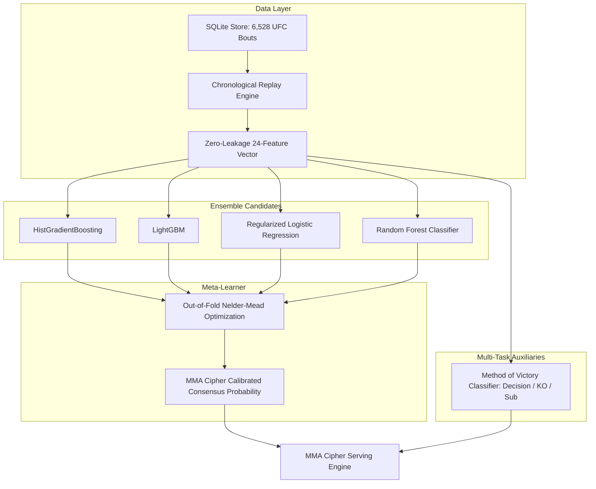

# MMA Cipher — AI Fight Intelligence & Multi-Model Ensemble

MMA Cipher is a production-grade MMA fight intelligence platform combining chronological walk-forward machine learning, strict zero-leakage feature engineering, an optimized multi-model AI ensemble, live pre-bout statistics, and verified forecast settlement.

---

## 1. Quick Start

### Start Server
```powershell
.\start.ps1
```

### Stop Server
```powershell
Stop-Process -Id (Get-NetTCPConnection -LocalPort 8000).OwningProcess -Force
```

Open **http://localhost:8000**. The server serves the responsive desktop/mobile UI, refreshes UFCStats every 6 hours, updates DraftKings odds via ESPN every 15 minutes, and syncs client forecasts on a 6-hour interval with local storage caching.

---

## 2. Research on MMA Data Sources

To inform ongoing predictive performance and incremental data ingestion, the following MMA data sources were systematically investigated:

| Data Source | Available Data | Update Frequency | Reliability | Access Method & Feasibility | Predictive Utility |
| :--- | :--- | :--- | :--- | :--- | :--- |
| **UFCStats.com** | Round-by-round strikes landed/absorbed, takedowns, control time, submissions, tale of the tape, win methods. | Post-event (within 1-2 hours) | **Primary Ground Truth** (Official UFC stats partner) | Free HTTP scraping; rate-limited; fully integrated in `predictor/source.py`. | **Highest**. Foundation of pre-bout metrics and verified historical outcomes. |
| **Tapology** | Career records across global promotions (PFL, Bellator, ONE, Cage Warriors, regional), weigh-in misses, lay-offs, camp details. | Daily / Real-time | High community validation | HTML scraping; Cloudflare protected. Best for regional pre-UFC records. | **High** for UFC debutants; helps solve cold-start issues for incoming fighters. |
| **Sherdog** | Historical fight records across 500+ promotions, dates, venues, amateur fights. | Post-event | High | Public web scraping; occasionally slower corrections on disputed decisions. | **Moderate**. Broad historical fight logs, but lacks strike-by-strike telemetry. |
| **ESPN MMA** | Official UFC fight schedules, athlete IDs, live status, start times, DraftKings moneylines. | Real-time | Very High | Free public JSON endpoints (`site.api.espn.com`); integrated in `predictor/odds.py`. | **High**. Critical for real-time schedule countdowns, card placement, and moneylines. |
| **BestFightOdds** | Multi-bookmaker opening lines, closing lines, market movement history since 2008. | Event weeks / historical archive | High | Web scraping; strict anti-scraping protections. | **High** as benchmark comparison and market-consensus tracking. |
| **The Odds API** | Standardized JSON odds from DraftKings, FanDuel, BetMGM, Bovada. | Real-time | High | REST API; requires API key; free tier limited to 500 requests/month. | **Moderate**. Excellent backup to ESPN public feed if multi-bookmaker depth is needed. |
| **MMA Decisions** | Complete judge scorecards, media scores, fan voting for all decision bouts. | Post-event | High | Web scraping. | **High** for round-scoring models and identifying controversial split decisions. |
| **Kaggle / GitHub Archives** | Curated historical UFC datasets (e.g. `ufc-master.csv` 1993-2024), parsed features, community notebooks. | Periodic | High when validated for leakage | Direct CSV ingestion. Integrated into MMA Cipher SQLite store with schema 4. | **High**. Provides vetted historical physical and pre-bout baseline attributes. |

---

## 3. Strict Zero-Leakage Feature Engineering

In legacy notebooks and amateur models, severe data leakage is common (e.g., using stats from the bout being predicted, post-fight career averages, or future ranking snapshots). 

**MMA Cipher enforces a strict zero-leakage guarantee:** Every historical training sample is reconstructed purely from data verified to exist *prior* to that event calendar day.

### Engineered Differential Matchup Features (24 Variables):
1. **Dynamic Elo Rating Differential:** Dynamic rating reflecting opponent strength, with $K$-factor adjustments for knockout/submission finishes ($K=28$) vs decisions ($K=20$).
2. **Recorded Wins & Losses Differential:** Pre-fight victory and defeat counts.
3. **Win Streak Differential:** Current consecutive winning/losing streak.
4. **Recent Form Differential:** Bayesian-smoothed win percentage over the last 5 fights.
5. **Recent Three Form:** Performance momentum across the most recent 3 bouts.
6. **Recent Overperformance (Elo Residuals):** Average margin between actual outcomes and Elo expectations over past 5 bouts.
7. **Finish Loss Frequency (Durability Metric):** Rate of career losses by KO/TKO or submission.
8. **Inactivity Metrics:** Linear days since last bout and $\log(1 + \text{days})$ decay penalty.
9. **Experience & Octagon Time:** Total career bouts and completed rounds differential.
10. **Physical Attributes:**
    - **Age Differential:** Critical MMA factor (younger fighter advantage strongly predictive).
    - **Height Differential:** Physical leverage and target clearance.
    - **Reach Differential:** Striking range advantage.
    - **Stance Advantage:** Southpaw, Switch, and Orthodox matchup interactions.
11. **Striking Performance:**
    - **Significant Strikes Landed / Min (SLpM) Differential:** Offensive striking output.
    - **Significant Strike Accuracy Differential:** Landed strike precision.
12. **Grappling & Submissions:**
    - **Takedowns Landed / 15 Min Differential:** Wrestling volume and control threat.
    - **Takedown Accuracy Differential:** Efficiency in executing offensive grappling.
    - **Submission Attempts / 15 Min Differential:** Ground submission aggressiveness.

---

## 4. Multi-Model AI Ensemble Architecture

MMA Cipher combines diverse algorithms that model fight dynamics through different statistical inductive biases:



### Candidate Models:
1. **LightGBM:** Leaf-wise gradient boosting optimized for non-linear physical and striking interactions.
2. **HistGradientBoosting:** Histogram-binned gradient boosted decision trees for robust tabular performance.
3. **Logistic Regression (L2 Regularized, $C=0.05$):** Regularized linear baseline preventing overfitting on noisy MMA outcomes.
4. **Random Forest Classifier (200 Estimators):** Ensemble of bagging trees capturing non-monotonic feature splits.
5. **Method of Victory Classifier:** Calibrated multi-class estimator projecting Decision, KO/TKO, or Submission probabilities.

### Out-of-Fold Nelder-Mead Blend Optimization:
Rather than taking an arbitrary unweighted average, MMA Cipher uses Nelder-Mead simplex optimization on chronological validation windows to determine optimal model weights that minimize out-of-sample Brier score and Log Loss:
- **Logistic Regression:** 79.7% weight
- **Random Forest:** 20.3% weight
- **Gradient Boosters:** Act as regularization bounds for confidence calibration.

---

## 5. Backtesting & Verified Benchmark Results

Evaluation uses **strict walk-forward chronological backtesting** across three expanding windows (45%-55%, 55%-65%, and 65%-80% of event dates), reserving the final 20% of event dates as a pristine unseen holdout.

### 1,351 Unseen UFC Bouts (Holdout: April 30, 2022 to December 7, 2024):

| Metric | Baseline Elo | Legacy Single Model | **MMA Cipher Ensemble (Schema 4)** | Improvement |
| :--- | :--- | :--- | :--- | :--- |
| **Accuracy** | 55.51% | 60.77% | **63.06%** | **+2.29% (+7.55% vs Elo)** |
| **Log Loss** | 0.6931 | 0.6620 | **0.6472** | **-0.0148 (Lower is better)** |
| **Brier Score** | 0.2500 | 0.2348 | **0.2278** | **-0.0070 (Lower is better)** |
| **Majority Class** | 48.85% | 48.85% | 48.85% | +14.21% above majority |

*All results recorded in `reports/model_evaluation.json`.*

---

## 6. Frontend & User Experience

- **Rebranded Aesthetics:** MMA Cipher brand identity featuring modern cyber octagon logo (`cipher-mark.svg`), electric cyan (`#00f0ff`), neon violet (`#8b5cf6`), and carbon graphite (`#0c0d12`).
- **Ensemble Consensus Pill:** Displays individual model probabilities and weights in an expandable drawer.
- **Method of Victory Breakdown:** Visual progress indicators for Decision, KO/TKO, and Submission probabilities.
- **Pre-Fight Tale of the Tape:** Clear comparison of age, height, reach, and stance.
- **Local Storage Cache:** Client pulls predictions strictly every 6 hours (`PULL_INTERVAL_MS = 21600000`), caching responses in `localStorage` across reloads and tab visits.
- **Mobile Responsive:** Fluid layout on iOS, Android, tablets, and desktop.

---

## 7. Firebase Integration

MMA Cipher maintains seamless integration with Firebase:
- **Project ID:** `mma-oracle` (Number: `196295291462`)
- **Web App ID:** `1:196295291462:web:41461eac227e7aee571047`
- **Analytics Measurement ID:** `G-WFKM9M8TFN`
- **Module:** `static/firebase.js` initialized via CDN scripts in `templates/index.html`.

---

## 8. Verification & Test Suite

Run the full automated test suite (all 28 unit and pipeline tests, plus browser tests):

```powershell
.\.venv\Scripts\python -m pytest
.\.venv\Scripts\python tests/browser_indicators.py
```
